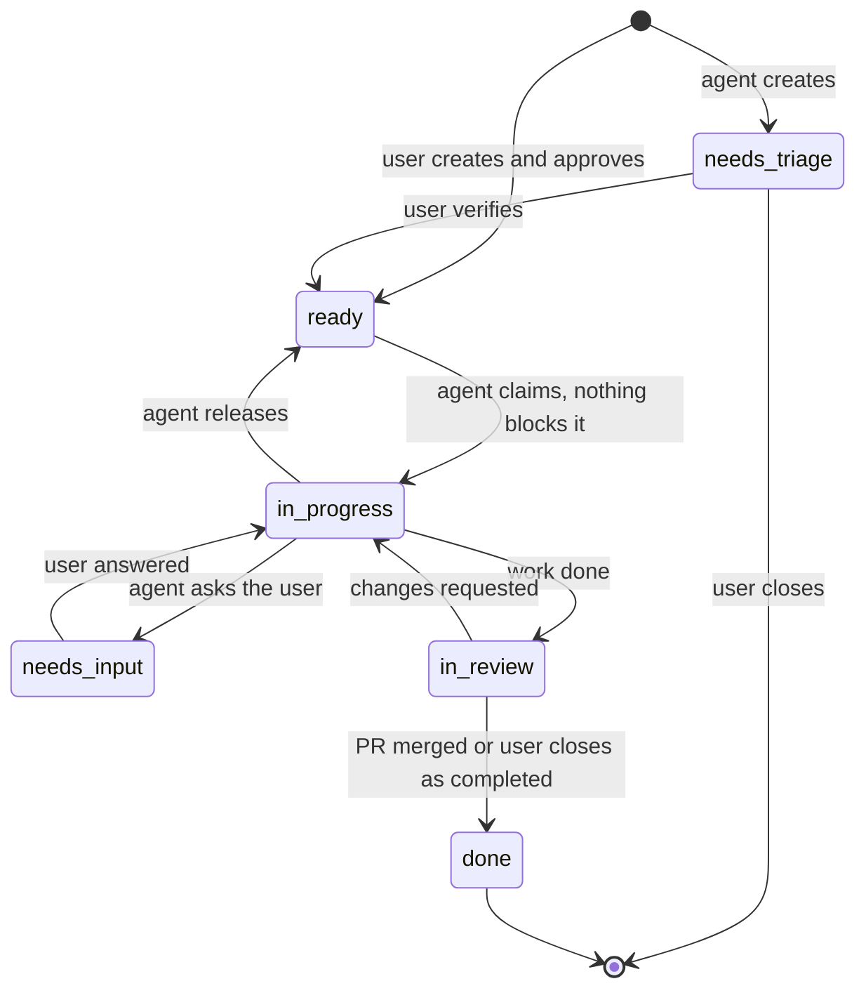

# Agent Guidelines

## Project overview

- This project uses ReScript and React.
- ReScript is the primary language for application logic and React components.
- TypeScript/JavaScript is used only where explicitly required for interoperability or tooling.

## Environment setup

### Node.js version

Before running project commands, change to the repository directory that contains `.nvmrc` and run `nvm use` there.
Do not run `nvm use` from a parent directory or a different working copy; use the `.nvmrc` that belongs to the
worktree where the project command will run.

If `nvm use` reports that the version from `.nvmrc` is not installed, remain in the directory containing `.nvmrc`
and run `nvm install` without a version argument so NVM installs the repository-pinned version. Then run `nvm use`
again. If the `nvm` command itself is unavailable, stop and report that NVM is not loaded or installed instead of
silently using a different Node.js version.

### Package manager

- This project uses [Bun](https://bun.sh) to manage dependencies; `bun.lock` is the lockfile.
- Use `bun install`, `bun add` and `bun remove` to manage dependencies, and `bun run <script>` to run `package.json` scripts.

## Documentation

### References

- ReScript language: https://rescript-lang.org/llms.txt
- ReScript React: https://www.rescript-lang.org/llms/react/llms.txt
- React: https://react.dev/llms.txt
- Vercel React Best Practices: use the installed `vercel-react-best-practices` skill when applicable.

### Usage requirements

- Use documentation matching the installed dependency versions.
- Do not assume ReScript v11 syntax or configuration is compatible with v12.
- Check the installed React version in `package.json` and `bun.lock` before using APIs introduced in newer React releases.
- Treat the latest React documentation as a reference for available features, not proof that those features are supported by the installed version or ReScript bindings.
- Before implementing or modifying React functionality, consult the relevant official React documentation.
- Use the React LLM documentation index to discover relevant pages. Read the specific documentation relevant to the APIs, hooks, components or concepts involved.
- Consult the ReScript React documentation to verify how React APIs are exposed through ReScript.
- Do not read the entire documentation for every change. Consult only the relevant sections.

## Implementation

### ReScript

- Prefer idiomatic ReScript over JavaScript-style translations.
- Use ReScript's type system instead of unnecessary runtime validation.
- Prefer pattern matching and explicit domain types.
- Avoid unnecessary JavaScript interop.
- Keep external library bindings isolated and documented.
- Follow the existing module and file organization.

### React

- Use function components and React hooks.
- Use the official React bindings rather than inventing custom React abstractions.
- Follow React's rules of hooks.
- Respect React rendering, state and effect semantics.
- Prefer typed component props.
- Follow existing conventions for events, refs, keys and JSX.
- Follow current official React recommendations rather than relying on potentially outdated LLM knowledge.
- Do not introduce React APIs or patterns without verifying their availability in the installed version and ReScript bindings.

### Fast Refresh

- Fast Refresh only works when a module exports nothing but React components. Exporting any other value disables it, and the browser console reports this.
- Give every component module (`*.res`) an interface file (`.resi`) that exposes only its components. Entry points such as `src/Main.res` that export nothing do not need one.

## Testing

- Component tests are ReScript files in `tests/**/*_test.res`. Run them with `bun run test`, which compiles ReScript first.
- Before writing, changing, debugging or extending tests or their bindings, load the `component-testing` skill. It covers the setup, the commands and the bindings.
- E2E tests are ReScript files in `e2e/**/*_spec.res`, run by Playwright Test against the production build. Run them with `bun run test:e2e`, which compiles and builds first. Bindings live in `e2e/bindings/Playwright.res`; wrap every test body in `withFixtures` and call `test` directly from the spec so Playwright can read the fixtures and report the spec location.

### No tautological tests

Tests must verify an independent behavioral contract and fail when that contract is broken. Do not compare a value with itself, derive the expected result from the implementation under test, or mock the behavior under test and only assert its configured return value. Use explicit expected results or an independent oracle, and limit mocks to collaborators.

### Test constants

When a test asserts a production contract, keep the expected value explicit in the test or in a test-local constant. Do not import production constants only to mirror the value being asserted, because the test would update with the implementation and stop catching unintended contract changes.

Production imports are fine for types, schemas, factories, enum values used to create valid setup data, or helpers that are not the expected value under assertion. If a production constant is part of the behavior being verified, repeat the expected literal in the test and let a production change break the test intentionally.

### E2E selectors

Use stable `data-testid` selectors for E2E assertions whenever possible. Avoid `.locator()` and `.getByText()` in E2E tests, and use exact string values for role `name` options instead of regular expressions.

## Validation

- Run the ReScript compiler after making changes.
- Fix compiler errors rather than suppressing them.
- Never assume generated JavaScript is correct without successful compilation.
- Run relevant tests.
- Verify JavaScript/TypeScript interoperability at integration boundaries.

## GitHub issues

- Before creating or triaging an issue, read [`docs/GITHUB_ISSUES.md`](docs/GITHUB_ISSUES.md) and apply its labels when the issue is created.
- To deliver an available issue end to end (claim, implement, code review, merge), use the `implement-issue` skill.
  To merge a PR, use the `merge-pr` skill.

### Issue status

Several agents work on issues in parallel. GitHub already records whether an issue is open or closed, which issues
block it and which sub-issues it has, so treat those as the single source of truth and do not mirror them in labels.
`status:*` labels record what GitHub cannot: which issues wait for the user to verify them, which issues the user has
approved for agents, which issue an agent is working on, which issues wait on the user, and which issues were completed.
An issue has at most one `status:*` label.

| Label                 | Meaning                                                       | Set by         |
| --------------------- | ------------------------------------------------------------- | -------------- |
| `status:needs-triage` | Created by an agent; the user has not verified it yet         | Creating agent |
| `status:ready`        | The user approved it for agents to pick up                    | User only      |
| `status:in-progress`  | An agent has claimed it and is working on it                  | Claiming agent |
| `status:needs-input`  | The claiming agent asked the user a question and waits        | Claiming agent |
| `status:in-review`    | Work is done and waits for the user to review, merge or close | Claiming agent |
| `status:done`         | Closed as completed                                           | Workflow       |

Every issue an agent creates starts as `status:needs-triage`. The user verifies it and replaces the label with
`status:ready`, edits it first, or closes it. An open issue without a `status:*` label was created by the user and is
not approved for agents yet; agents leave it alone.

An issue labelled `status:ready` is **available** only when nothing blocks it:

- every issue in its "blocked by" list is closed;
- every sub-issue is closed, or it has none (claim open sub-issues instead of their parent);
- it has no `needs-decision` label.

Issues that need the user are those labelled `status:needs-triage`, `status:needs-input`, `status:in-review` or
`needs-decision`.

#### Rules

- Agents share the user's GitHub account, so assignees cannot tell agents apart. Ownership is recorded with claim
  comments that name a stable agent ID, such as the session ID, or the agent name plus its branch.
- Add `status:needs-triage` to every issue you create. Never add `status:ready` yourself; only the user approves
  issues for agents.
- Only claim available issues. Never take over an issue another agent owns unless the user asks you to.
- Work in one claimed issue at a time unless the user assigns several.
- Record dependencies as GitHub "blocked by" links and sub-issues, not only as text in the issue body.
- Do not close issues yourself. A merged PR that references the issue closes it, otherwise the user closes it.
- Do not set `status:done` yourself. The [`Issue status`](.github/workflows/issue-status.yml) workflow replaces the
  `status:*` label with `status:done` whenever an issue is closed as completed, including by a merged PR.
- When you merge a PR, including when the user asks you to, check that each issue it references was closed. If the
  merge did not close an issue, for example because the PR has no closing keyword, tell the user instead of closing it.

#### Claiming an issue

1. Re-read the issue, its "blocked by" list and its sub-issues, and confirm it is still available.
2. Post a comment whose first line is `agent-claim: <agent-id>`.
3. Re-read the comments. If another `agent-claim` comment was posted before yours and has no later matching
   `agent-release`, you lost the race: delete your comment and pick another issue.
4. Otherwise replace `status:ready` with `status:in-progress`, for example:
   `gh issue edit <n> --remove-label status:ready --add-label status:in-progress`.

#### While working

- When you need the user, ask in an issue comment or in the session, and switch to `status:needs-input`. Switch back
  to `status:in-progress` once the user has answered.
- When the work is done, switch to `status:in-review`. If changes are requested, switch back to `status:in-progress`.
- If you stop before finishing, post `agent-release: <agent-id>` with a short summary of what is done and what is
  left, and switch back to `status:ready`. If you found a blocker, also record it as a "blocked by" link.

## Pull requests

Pull requests are reviewed by review agents. Repository and reviewer settings decide which agents review and make
them review every push, so instructions and skills never name a reviewer or request reviews: they wait for reviews of
the head commit instead.

- **Required approvals: 2.** A reviewer approves a PR when its latest review is on the head commit, is not
  `CHANGES_REQUESTED`, and every review thread it opened is resolved. A `COMMENTED` review counts too, because not
  every review agent submits `APPROVED` reviews. Reviews by the PR author do not count.
- **No unresolved conversations.** A PR is merged only when every review thread is resolved.
- **The agent that opened the PR owns its threads.** It addresses each thread by fixing it or replying with its
  reasoning, then resolves it. Reviewers are not expected to resolve threads. It also reads each review's summary
  and addresses concerns raised there that have no thread.
- [`review-status.sh <pr>`](.agents/skills/merge-pr/scripts/review-status.sh) reports each reviewer's latest review,
  the approvals of the head commit and the unresolved threads.

## Git

- Do not sign yourself in any git commit (adding Co-authored-by) unless I ask you to.
- Work in the main checkout unless I specify otherwise. Do not implicitly create a new branch or work in a worktree.
- Automated work, such as the `implement-issue` skill, always runs in a dedicated git worktree on its own branch.
- Group related changes into separate, focused commits instead of one large commit. Each commit should contain one logical change together with its related documentation and tests, and commits should be ordered so that each one builds on the previous ones.

## Responses

- Follow instructions silently. Don't mention that you followed a rule from AGENTS.md, memories or elsewhere.
- Mention an instruction only if it stopped you from doing what I asked, or if two instructions conflict.
