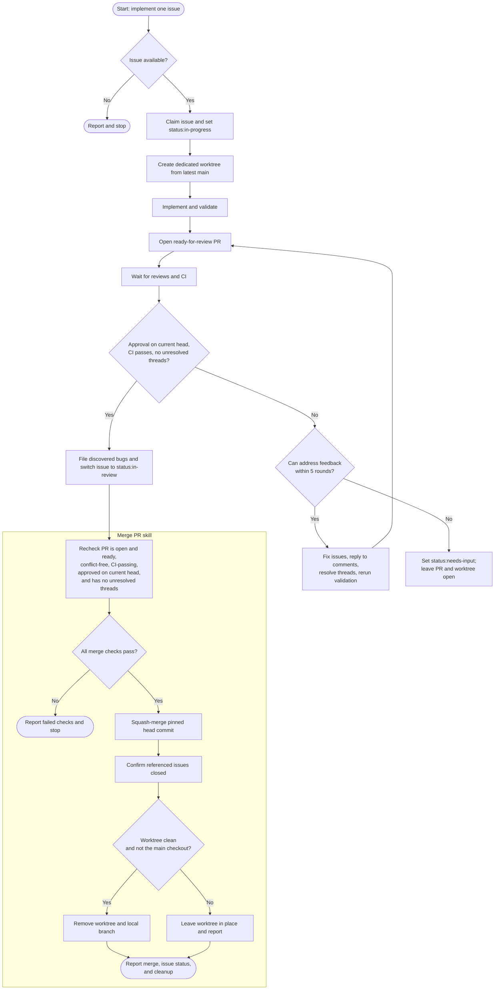

# Implementation and merge workflow

The [`implement-issue` skill](../.agents/skills/implement-issue/SKILL.md) takes one available issue from claim through implementation and review. When its merge checks pass, it hands the PR to the [`merge-pr` skill](../.agents/skills/merge-pr/SKILL.md), which rechecks the merge conditions, merges, confirms issue closure, and cleans up the worktree when it is safe.

